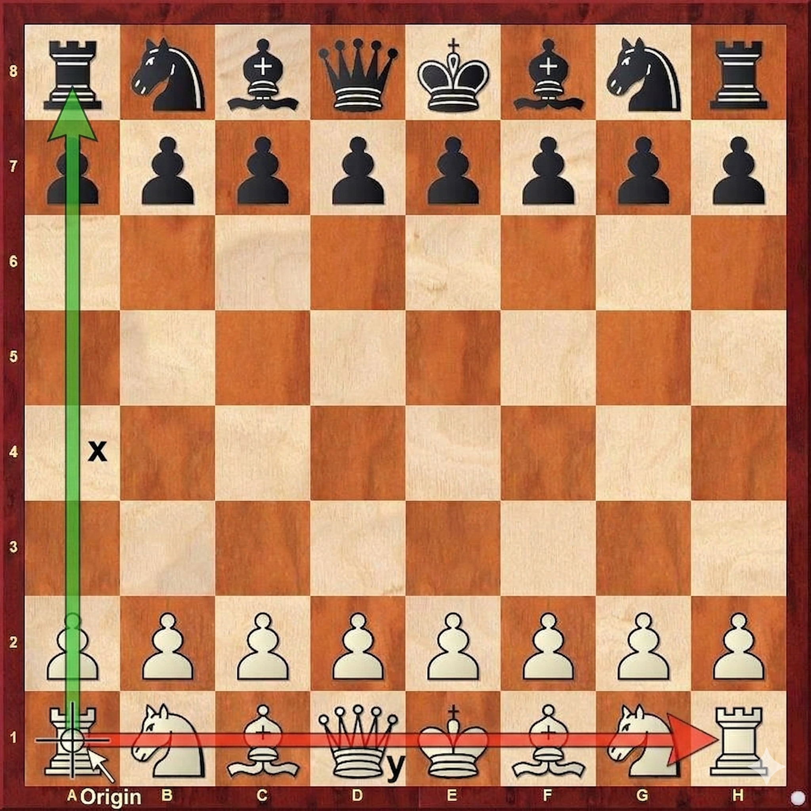

# comparing-chess-engine
Create a chess engine and compare it to a dumb one.

## Turn-Based Game Controller
The flow of the game is driven by a turn-based loop inside the `game_controller()` function in `main.py`:

1. **Board Representation:** The game board is an 8x8 list, where pieces are represented by integers (positive for White, negative for Black).
2. **Turn Alternation:** A boolean flag (`white_turn`) switches control between `player_one` (smart engine) and `player_two` (dumb engine) each iteration.
3. **Engine Execution:** During their turn, the engine evaluates the current board and updates the 8x8 matrix directly to execute their move.
4. **Win Condition Check:** After each move, the board is scanned to verify if the opposing King is still alive. If a King is captured, the game ends.
5. **Pacing:** To make debugging and observing the game easier, the turn loop is paused after every play. The user must press **Enter** in the terminal to advance to the next state.
